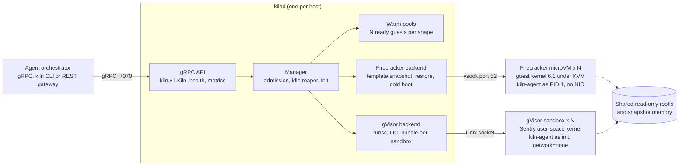

# Kiln

Kiln gives an AI agent a private Linux machine in about 30 ms and keeps the host's memory cost near 7 MiB per idle sandbox. It is a Go service that runs untrusted code in Firecracker microVMs or gVisor containers behind one gRPC API, with a FastAPI gateway for HTTP clients, Terraform for a GCP host pool, and a benchmark harness for cold start, throughput and density.

Coding agents need somewhere to run shell commands, edit files and run tests across many steps. That place has to keep its state between calls, start fast enough that the agent never waits on it, and stay sealed off from the host and from other tenants. A Kiln sandbox is a long-lived workspace: create it, exec into it as often as needed, move files in and out, then delete it or let the idle reaper collect it.

| Start path (Firecracker) | Time to first exec, p50 | Host memory per idle sandbox |
| --- | --- | --- |
| Warm pool | 30.2 ms | 6.7 MiB |
| Snapshot restore | 57.9 ms | 6.7 MiB |
| Cold boot | 255.1 ms | 42.3 MiB |

Time to first exec runs from the CreateSandbox call until `python3 -c pass` has finished inside the guest. Numbers come from a 2015 dual-core laptop; see [Benchmarks](#benchmarks).

## Architecture



Each host runs one `kilnd`. The manager admits a request against a sandbox count limit and a host free-memory floor, takes a guest from the matching warm pool or starts one through a backend, personalises it, and tracks it until deletion or idle timeout. Both backends run the same static `kiln-agent` binary inside the guest, so exec, file transfer and timeouts behave the same on either.

```
proto/kiln/v1/kiln.proto        public gRPC API
proto/kiln/agent/v1/agent.proto host <-> guest agent protocol
cmd/kilnd                       host daemon
cmd/kiln                        CLI
cmd/kiln-agent                  in-guest agent (static, PID 1 in microVMs)
cmd/kiln-bench                  benchmark harness
internal/firecracker            Firecracker API client, boot, snapshot, restore
internal/sandbox                manager, warm pools, Firecracker and gVisor backends
internal/agent                  agent server: exec, files, reaper, guest setup
internal/vsock                  AF_VSOCK listener and Firecracker vsock dialer
gateway/                        FastAPI REST gateway
deploy/terraform/               GCP host pool
bench/                          runner script and results
```

## API

The public surface is one gRPC service, `kiln.v1.Kiln`. `kilnd` also serves the standard gRPC health service, server reflection for grpcurl, and Prometheus metrics (`kiln_sandbox_start_seconds` by backend and start mode) on port 9090.

| RPC | What it does |
| --- | --- |
| CreateSandbox | Starts or hands out a sandbox; returns its id, how it started (cold boot, snapshot restore or warm pool) and the ready latency |
| Exec | Runs argv inside the sandbox and streams stdout and stderr; the last event is an ExitStatus with code, signal, timeout flag and duration |
| WriteFile, ReadFile | Moves files in and out without a shell |
| Run | Create, write files, exec and delete in one call |
| GetSandbox, ListSandboxes, DeleteSandbox | Lifecycle |
| Stats | Pool fill levels and host memory |

Exec takes a per-call timeout and a per-stream output cap. Output past the cap is drained and dropped so the child never blocks on a full pipe, and the exit status reports `output_truncated`. CreateSandbox has two flags for benchmarking: `force_cold_boot` skips the pool and the snapshot, and `skip_pool` restores from the snapshot but bypasses the pool.

```bash
kiln run -- python3 -c 'print(6*7)'
id=$(kiln create -backend gvisor)
kiln put $id ./solution.py solution.py
kiln exec $id -- python3 solution.py
kiln exec $id -- sh -c 'git init -q repo && git -C repo status'
kiln rm $id
```

The REST gateway maps the same calls to JSON. Exec returns buffered JSON, or server-sent events when the client sends `Accept: text/event-stream`.

```bash
cd gateway && pip install -r requirements.txt
KILN_ADDR=localhost:7070 uvicorn app:app --port 8080

curl -XPOST localhost:8080/v1/run -H 'content-type: application/json' \
  -d '{"exec":{"argv":["python3","-c","print(6*7)"]}}'
curl -N -XPOST localhost:8080/v1/sandboxes/$ID/exec -H 'accept: text/event-stream' \
  -H 'content-type: application/json' -d '{"argv":["sh","-c","make test"]}'
```

## How a sandbox starts fast

A cold Firecracker boot takes about 180 ms to reach a ready agent and another 70 ms or more before Python has run once. Kiln moves that work off the request path in four steps.

1. Template snapshot. At startup kilnd boots one VM per template and shape, waits for the agent, runs a warmup (`python3 -c 'import json,os,re,subprocess,sys'`) so the interpreter and stdlib are in guest page cache, then pauses the VM and writes a full snapshot of VM state and guest memory.
2. Restore with shared memory. A new sandbox is a Firecracker process that loads that snapshot with a file memory backend. Guest RAM is mapped privately from the snapshot file, so pages fault in lazily and all clones share the clean ones through the host page cache. Only pages a guest writes become private to it.
3. Warm pool. Each pool keeps N restored guests ready, and runs `python3 -c pass` in each one before parking it so first-touch page faults happen early. A pool hit is a channel receive. This step cut warm-pool time to first exec from 49 ms to 30 ms. Refills run in the background under a host-wide concurrency limit so they do not starve on-demand creates.
4. Personalisation. Every clone wakes with the template's clock, hostname and RNG state. Before handing a guest out, kilnd calls the agent's Init RPC, which sets the wall clock, sets the hostname to the sandbox id and credits 64 bytes of host randomness to the guest pool with `RNDADDENTROPY`. The guest kernel is also built with VMGENID.

A Firecracker snapshot records the paths of the root drive and the vsock socket. Kiln writes those as relative paths and starts every Firecracker process with its own directory as the working directory, so `rootfs.ext4` and `v.sock` resolve to per-VM files and many clones of one snapshot never collide. This is the same layout the jailer's chroot gives.

## Isolation model

A Firecracker sandbox has its own guest kernel behind KVM, and its only channel to the host is a vsock port that the host dials. The VM has no network device, so code inside can reach loopback and nothing else. The agent brings `lo` up so tests that start a local server still work.

| Layer | Firecracker backend | gVisor backend |
| --- | --- | --- |
| Kernel boundary | Guest kernel 6.1 under KVM | gVisor Sentry, systrap platform |
| Host channel | vsock port 52, host-initiated | Unix socket in a per-sandbox bind mount |
| Network | No NIC, loopback only | `--network=none` |
| Root filesystem | Shared read-only ext4 plus a tmpfs overlay inside the guest | Shared read-only directory plus runsc's memory overlay |
| Limits | vCPU count and guest RAM fixed per VM | OCI CPU quota and memory limit |
| VMM hardening | Firecracker's built-in seccomp filters | runsc seccomp and namespaces |

Inside a microVM the agent runs as PID 1. It mounts a tmpfs, stacks an overlay on the read-only root and switches into it, so writes land in guest RAM that the VM's memory size already caps, and no per-sandbox disk copy exists. As PID 1 it also reaps orphaned processes. Each command runs in its own process group, so a timeout kills the whole tree. Background processes may outlive a command (an agent may start a server), and Exec returns after a 50 ms drain even if they still hold the output pipes.

Gaps in the current build:

- kilnd runs Firecracker without the jailer, so the VMM process has no chroot, uid drop or per-VM cgroup yet.
- The local benchmark runs gVisor with `--ignore-cgroups`, so its memory and CPU limits are not enforced there.
- Sandboxes have no egress. Agents that need package mirrors would need a filtered proxy over vsock.

## Benchmarks

All numbers are from one run of `bench/run.sh` on an Intel Core i5-6200U (2 cores, 4 threads, 2015) with 16 GB RAM, Linux 7.0, Firecracker 1.17.0 and gVisor 20261005.0 (systrap). Both backends ran inside the same privileged container, and every guest had 1 vCPU and 512 MiB. Raw JSON is in [`bench/results/20261011-202911`](bench/results/20261011-202911).

### Startup

Time to first exec is the CreateSandbox round trip plus the first `python3 -c pass`. Each row is 50 samples (100 for gVisor cold start).

| Backend | Start path | CreateSandbox p50 | Time to first exec p50 | p99 |
| --- | --- | --- | --- | --- |
| Firecracker | Warm pool | 1.9 ms | 30.2 ms | 46.9 ms |
| Firecracker | Snapshot restore | 19.0 ms | 57.9 ms | 63.3 ms |
| Firecracker | Cold boot | 182.6 ms | 255.1 ms | 264.1 ms |
| gVisor | Warm pool | 2.5 ms | 108.4 ms | 142.3 ms |
| gVisor | Cold start | 86.5 ms | 192.0 ms | 273.1 ms |

gVisor starts a fresh sandbox faster than Firecracker boots a kernel, but runs the first Python process far slower. The gVisor backend has no snapshot path yet, so it has no restore row.

### Exec round trip

Client-observed latency for one Exec RPC in an already-warm sandbox, 200 runs each.

| Command | Firecracker p50 / p99 | gVisor p50 / p99 |
| --- | --- | --- |
| `true` | 2.31 / 3.61 ms | 5.15 / 12.90 ms |
| `python3 -c pass` | 23.6 / 30.4 ms | 63.8 / 88.7 ms |
| `echo hi > f && cat f` | 4.62 / 7.03 ms | 13.05 / 21.04 ms |

### Burst throughput

C clients each create a sandbox at once, bypassing the pool, and run the probe once. Throughput is completed sandboxes per second.

| Concurrency | Firecracker restore | Firecracker cold boot | gVisor |
| --- | --- | --- | --- |
| 1 | 9.6 /s | 3.2 /s | 3.4 /s |
| 4 | 23.8 /s | 7.6 /s | 4.5 /s |
| 8 | 24.9 /s | 7.4 /s | 5.3 /s |
| 16 | 25.1 /s | 6.5 /s | 5.1 /s |
| 32 | 25.1 /s | 6.6 /s | 4.7 /s |

Restores level off at about 25 per second on 4 hardware threads. At 32 concurrent creates the median time to first exec is 865 ms for restores, 4.2 s for cold boots and 5.1 s for gVisor.

### Density

Sandboxes were started one at a time and kept alive, each having run the probe once. The run stopped at 100 sandboxes or when host MemAvailable fell below 3 GiB.

| Path | Sandboxes | Host MemAvailable drop | Per sandbox | Summed PSS per sandbox |
| --- | --- | --- | --- | --- |
| Firecracker snapshot restore | 100 | 666 MiB | 6.7 MiB | 5.8 MiB |
| Firecracker cold boot | 85, hit the memory floor | 3598 MiB | 42.3 MiB | 66.4 MiB |
| gVisor | 100 | 1604 MiB | 16.0 MiB | not comparable |

Restored clones cost a sixth of a cold-booted VM by MemAvailable and an eleventh by PSS, because they share the snapshot's clean pages. MemAvailable is the only measure applied to all three paths. Summed PSS misses gVisor's guest memory file, so it is shown for Firecracker only. The laptop was running a desktop session, so MemAvailable readings below about 15 sandboxes are noise; the totals above are the stable figures.

## Deployment on GCP

`deploy/terraform` stands up a pool of sandbox hosts on Compute Engine VMs with nested virtualization, so Firecracker has `/dev/kvm`.

| Resource | Purpose |
| --- | --- |
| VPC, subnet, Cloud Router and NAT | Private hosts with no public IPs; NAT serves only the host OS |
| Firewall rules | gRPC 7070 from `client_cidrs`, Google health checkers, SSH only from the IAP range |
| Artifacts bucket | Terraform uploads kilnd, the kernel and rootfs images under content-addressed names |
| Host service account | Reads the bucket and writes logs and metrics |
| Instance template | n2-standard-8, nested virtualization, SMT off, Shielded VM, Ubuntu 24.04 |
| Startup script | Installs pinned Firecracker and gVisor with sha256 checks, fetches artifacts, applies sysctls and KSM, runs kilnd under systemd |
| Regional managed instance group | Fixed size, autohealing on the gRPC health check, surge-first rolling updates |

The group size is fixed because sandboxes are stateful: scaling in a host destroys every sandbox on it, so capacity changes are a deliberate `host_count` edit. A new build changes the artifact object names, which changes the instance template and rolls the pool one host at a time with surge capacity first.

```bash
make build image
cd deploy/terraform
cp terraform.tfvars.example terraform.tfvars   # set project_id
terraform init && terraform apply
```

The configuration passes `terraform validate`. It has not been applied to a real project yet.

## Running it locally

You need Linux with read-write access to `/dev/kvm`, Go 1.26 and Docker. Firecracker runs unprivileged. gVisor needs root, so the benchmark runner puts both backends in a privileged container that stands in for a production host.

```bash
make tools                  # pinned Firecracker, gVisor, protoc, Terraform into .tools/
make build image            # binaries into bin/; rootfs and kernel into build/
bin/kilnd -firecracker .tools/bin/firecracker -pools firecracker/python=4
bin/kiln run -- python3 -c 'print(6*7)'
bin/kiln stats

bench/run.sh                # full suite, both backends, JSON into bench/results/
```

`make image` builds the guest root filesystem from `python:3.12-alpine3.22` with bash, git and curl, exports it as a tarball for gVisor and an ext4 image for Firecracker, and downloads the Firecracker CI 6.1 guest kernel. The integration test boots a real VM, snapshots it and restores three clones:

```bash
KILN_FIRECRACKER=$PWD/.tools/bin/firecracker go test ./internal/firecracker -run Integration -v
```

## Next steps

- Run each Firecracker process through the jailer. The per-VM working directory already matches the jailer's chroot layout, so this means hard-linking the kernel, rootfs and snapshot into it.
- Cut first-exec time after restore. Restored guests still pay page faults on their first real work (58 ms to first exec against about 24 ms for a hot Python run). Firecracker's userfaultfd memory backend would let kilnd prefetch the pages the template touched during warmup in one batch.
- Add a placement layer. Each host runs its own kilnd; a fleet needs a router that picks a host by free memory and pool depth and pins the sandbox id to it.
- Use gVisor checkpoint and restore to give the gVisor backend a snapshot path.
- Add an allowlisted egress proxy over vsock so agents can reach package mirrors without a network device.
